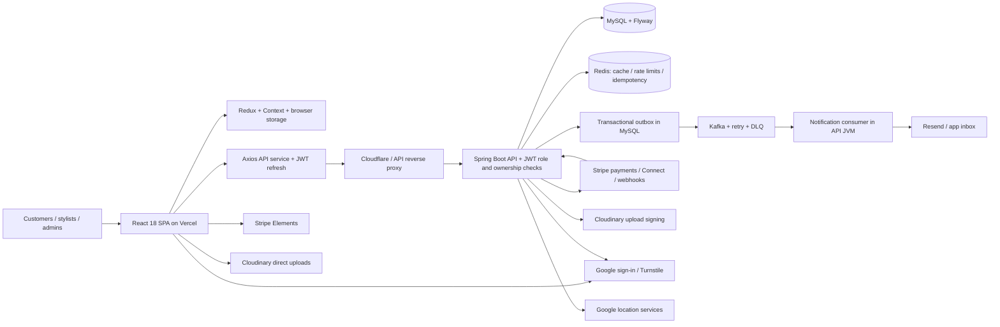

# RapidStylers architecture and release readiness

Current status: see [the architecture gap re-audit](architecture-gap-status-2026-10-10.md). This document records earlier findings; implementations and verification status have changed.
Assessment date: October 10, 2026. Scope: current frontend checkout, backend source and configuration, frontend tests/build, and signed-out local browser smoke tests. Deployment topology is declared by repository configuration/documentation, not verified against live infrastructure. Backend files were not changed.

## Current architecture

The backend is one deployable containing controllers, business services, outbox publishing and Kafka consumers. MySQL is authoritative; Redis accelerates and coordinates selected workflows. Kafka handles notification side effects. Payments already have implemented Stripe services and webhook handling; the backend README's “planned final phase” label is stale. Browser route guards improve navigation; server JWT role and ownership checks remain the security boundary.

Frontend entry points are `src/App.js` and `src/index.js`. Routes are lazy loaded. Customer state uses Redux plus local profile snapshots, with Context for location and stylist signup. Access/refresh tokens and role hints use sessionStorage. API calls pass through `src/hooks/remote/apiService.js` and `apiClient.js`; the JSON client normalizes business failures and refreshes on HTTP 401. Vercel defines CSP, security headers, SPA rewrites and hashed asset caching.

## Confirmed frontend gaps

| Priority | Finding and evidence | Required change |
| --- | --- | --- |
| P1 | Admin sign-out only calls `localStorage.clear()` (`src/pages/admin/adminShell.js:50`). Access/refresh tokens and admin flag remain in sessionStorage. `adminLogin.js:22` redirects an existing admin session back to categories. | Revoke refresh token best effort, clear session credentials and role hints immediately, clear only application-owned profile/draft data, then redirect. Add a functional regression proving protected pages are inaccessible after logout. |
| P1 | Booking posts no `Idempotency-Key` (`src/hooks/remote/apiService.js:678`, `src/components/selectService.js:430`). Backend controller consumes this header and service only enables idempotency when it is present. Slot locks do not provide response replay. | Generate a key for one booking intent, retain it across uncertain failures/retries, reset when the intent changes. Test a lost response followed by retry. Confirm backend replay behavior in staging. |
| P2 | Empty login submission makes an API request and displays “Network Error” (`src/pages/generalPages/login.js:87`). Reproduced in browser without entering credentials. | Validate required email/password and email shape, associate field messages with inputs, avoid calling the API for invalid forms. Test keyboard and assistive technology behavior. |
| P2 | Both Axios instances have no explicit timeout (`apiClient.js`). A stalled request can keep UI work pending indefinitely. | Define request deadlines and cancellation where navigation/search supersedes a request; treat payment/booking timeouts as uncertain outcomes rather than automatically repeating mutations. |
| P2 | JSON refresh queue replays queued requests without setting `_retry`; multipart client has no 401 refresh handler (`apiClient.js:70`, response interceptors). | Bound refresh/retry attempts consistently across clients; test parallel 401s, rotated refresh rejection, network failure and logout during refresh. The race behavior needs a dedicated regression before claiming a reproduced exploit. |
| P2 | Build emits a 9.83 MB hero video, 3.71 MB mobile mockup and two ~594 kB logo SVGs. Hero imports/autoplays the large video (`newHeroSection.js:19,132`). | Compress/simplify assets, use poster and appropriate video loading/motion behavior, measure mobile performance on the production build. Emitted size is verified; actual mobile transfer and Core Web Vitals remain unmeasured. |
| P1 release gate | CI runs Vitest and a build, but no browser end-to-end job is present (`.github/workflows/ci.yml`, package scripts). | Add repeatable browser tests against staging with seeded customer/stylist/admin accounts and Stripe test mode. Cover booking, payments, uploads, OTP, route access and logout; gate release on results. |

## Backend owner actions

1. **Resolve schema configuration mismatch before release.** `src/main/resources/application.properties:21` uses `spring.jpa.hibernate.ddl-auto=update`; tests use `validate`, and README says Flyway exclusively owns schema changes. Set the intended runtime policy to validate after testing migrations on fresh and existing databases. Verify production overrides explicitly; deployed effective configuration was not inspected.
2. **Treat browser API key as public.** `REACT_APP_API_KEY` is injected into frontend JavaScript and sent as `x-api-key`; it cannot prove a trusted caller or replace authorization. Confirm JWT ownership, role checks and server abuse controls protect each sensitive endpoint. This is an architecture constraint, not evidence of an authorization bypass.
3. **Coordinate refresh-token hardening.** Access and refresh tokens are currently readable by page JavaScript. Consider an HttpOnly, Secure cookie refresh flow or a same-origin backend-for-frontend with explicit CSRF/CORS design. This needs backend changes and coordinated frontend tests. No XSS exploit was confirmed in the reviewed paths. [OWASP storage guidance](https://cheatsheetseries.owasp.org/cheatsheets/HTML5_Security_Cheat_Sheet.html#storage-apis).
4. **Provide verified staging contracts and test fixtures.** Require actual replay/conflict responses for idempotency, authoritative prices and travel estimates, signed upload restrictions, payment decline/authentication outcomes, refund state and webhook reconciliation. These implementations exist in parts of the backend, but no live business workflow was validated in this assessment.

Local defaults disagree too: frontend falls back to `https://localhost:9090/rapid_stylers`, backend defaults to port 9095. Establish one documented local configuration without printing real keys or editing production secrets.

## Verification evidence and limits

- `npm test -- --reporter=dot`: 73 files, 696 tests passed; exit 0. React `act`/router warnings and jsdom unsupported navigation/scroll warnings remain. Passing mocked component tests do not establish working backend integrations.
- `npm run build`: exit 0. Vite configuration format warning and a Lottie direct-eval warning remain. CSP does not allow unsafe-eval; verify deployed animations under actual Vercel headers before deciding whether to replace the player. The warning alone is not a confirmed vulnerability.
- Local browser: landing rendered; Login navigation worked; empty login failed field validation as described above; signed-out `/styler-dashboard` and `/dashboard` redirected to `/login`, and `/admin/categories` redirected to `/admin/login`.
- Catalog on local landing showed no professionals; successful live catalog, account, OTP, booking, card, payout, refund or upload operations were not established. No test credentials were provided or used. No real financial transactions were attempted.
- Backend test suite, live headers, dependency advisory audit, authorization penetration tests, mobile viewport and accessibility audits were not completed. This report is not a security certification or a zero-vulnerability claim.

## Frontend delivery agreement and proposed order

Own frontend implementation; read backend context and report backend changes separately. Perform relevant functional tests for each change and report exactly what ran and what remains unverified. Start with session teardown and authentication validation, then booking idempotency/API resilience, then staging browser coverage and payment/upload contract verification, then mobile accessibility and performance. Release readiness requires all blocking workflows and security checks to pass against the deployed configuration.
